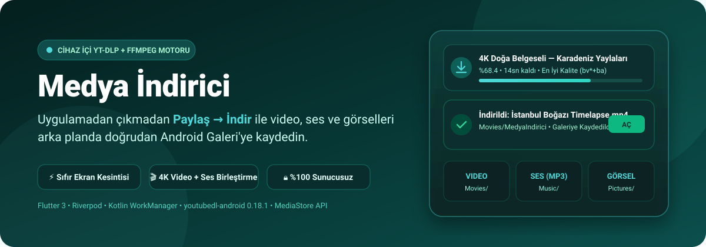
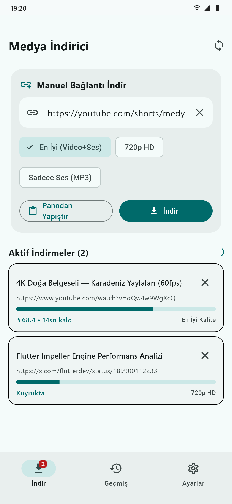
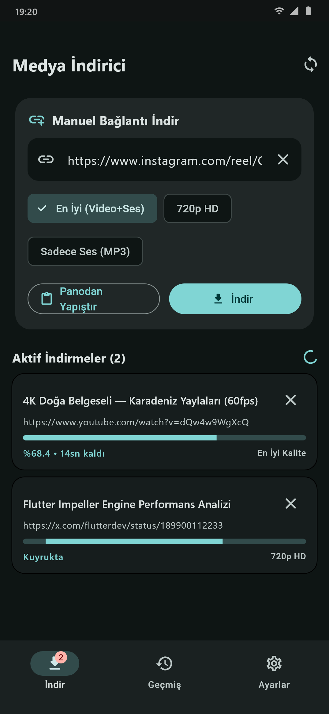
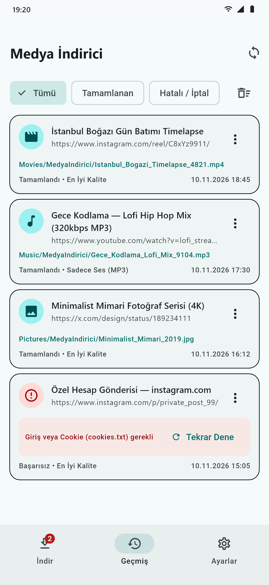
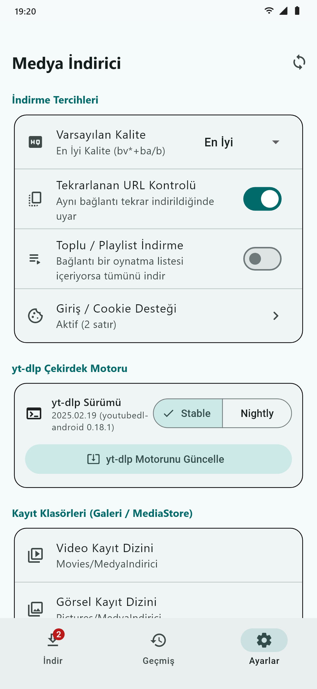
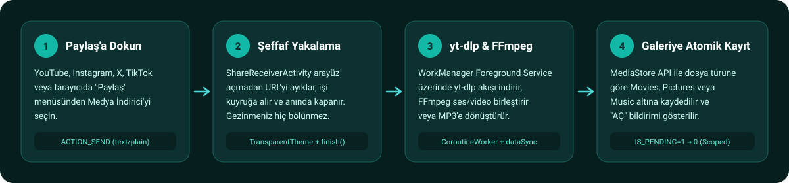
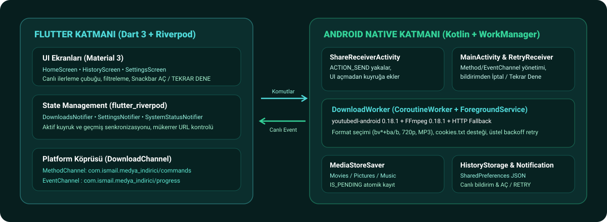
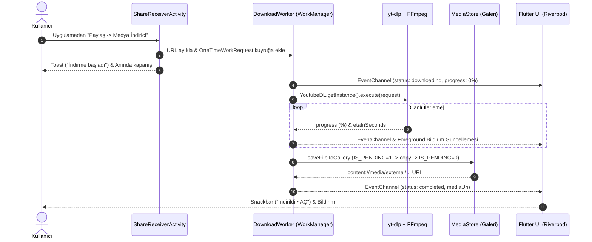

<p align="center">
  
</p>

<p align="center">
  
  
  
  
</p>

# Medya İndirici

**Medya İndirici**, Android cihazlarda bulunduğunuz uygulamadan çıkmadan **Paylaş → Medya İndirici** akışıyla video, ses (MP3) ve görselleri arka planda indirip doğrudan Android **Galeri**'ye (`MediaStore`) kaydeden, tamamen cihaz içi (**sunucusuz**) bir medya indirme uygulamasıdır.

- ⚡ **Sıfır Ekran Kesintisi (`ShareReceiverActivity`):** YouTube, Instagram, X (Twitter), TikTok veya tarayıcıda *Paylaş* menüsünden seçildiğinde arayüz açmadan bağlantıyı yakalar, indirmeyi arka plan kuyruğuna ekler ve anında kapanır.
- 🎬 **Cihaz İçi `yt-dlp` + `FFmpeg` Motoru:** Harici bir API veya ara sunucu kullanmaz. Yüksek çözünürlüklü ayrı video ve ses akışlarını (`bv*+ba/b`) cihaz üzerinde FFmpeg ile birleştirir veya doğrudan MP3 ses dosyasına dönüştürür.
- 📂 **Atomik Galeri Kaydı (`MediaStore`):** İndirilen dosyalar türüne göre otomatik sınıflandırılır ve `IS_PENDING=1 → 0` atomik protokolüyle bozuk/yarım dosya oluşmadan doğrudan Galeri'de görünür:
  - **Video:** `Movies/MedyaIndirici`
  - **Görsel:** `Pictures/MedyaIndirici`
  - **Ses:** `Music/MedyaIndirici`
- 🔄 **Akıllı Hata Yönetimi ve Otomatik Yeniden Deneme:** Geçici ağ kopmalarında üstel geri çekilme (*Exponential Backoff*) ile otomatik yeniden dener; hata durumunda hem bildirimden hem uygulama içinden tek dokunuşla **Tekrar Dene** aksiyonu sunar.
- 🍪 **Cookie (`cookies.txt`) ve Motor Güncelleme:** Giriş gerektiren içerikler için Netscape formatında çerez desteği ve uygulama içinden tek tıkla `yt-dlp` (`STABLE` / `NIGHTLY`) çekirdek güncellemesi barındırır.

---

## Ekran Görünümleri

Proje içerisindeki bileşenlerden (`MainShellScreen`, `HomeScreen`, `HistoryScreen`, `SettingsScreen`) doğrudan üretilen ekran görünümleri:

<p align="center">
  
  
  
  
</p>

| Ekran | Öne Çıkan Özellikler |
|---|---|
| **İndir (`HomeScreen`)** | Manuel URL yapıştırma, indirme başına anlık kalite seçimi (*En İyi*, *720p HD*, *Sadece Ses MP3*), canlı yüzdelik ve kalan süre (`ETA`) takibi, pil/bildirim izin rehberi. |
| **Geçmiş (`HistoryScreen`)** | *Tümü / Tamamlanan / Hatalı* filtreleme, tamamlanan medyayı doğrudan varsayılan oynatıcıda açma, başarısız indirmeleri tek dokunuşla yeniden başlatma, geçmiş temizleme. |
| **Ayarlar (`SettingsScreen`)** | Varsayılan kalite, mükerrer URL uyarısı, playlist indirme anahtarı, Netscape `cookies.txt` tanımlama, `yt-dlp` kanal seçimi (`Stable`/`Nightly`) ve motor güncelleme. |

---

## Nasıl Çalışır?

<p align="center">
  
</p>

1. **Paylaş Menüsü (`ACTION_SEND`)** — Herhangi bir sosyal medya veya video uygulamasında *Paylaş* butonuna basıp **Medya İndirici** seçilir.
2. **Şeffaf Yakalama (`ShareReceiverActivity`)** — `TransparentTheme` kullanan aktivite metin içerisindeki ilk `http/https` bağlantısını 정규 (regex) ile ayıklar, mükerrerlik kontrolü yapar, işi `WorkManager` kuyruğuna ekler ve `finish()` ile milisaniyeler içinde kapanır.
3. **Arka Plan İşleme (`DownloadWorker`)** — `CoroutineWorker` ve `FOREGROUND_SERVICE_TYPE_DATA_SYNC` üzerinde çalışan işçimiz `youtubedl-android` ile medyayı çözümler. Görsel bağlantılarında doğrudan HTTP yedek (*fallback*) indiriciyi devreye sokar.
4. **Galeriye Kayıt ve Bildirim (`MediaStoreSaver` & `NotificationHelper`)** — Geçici önbellekten (`cacheDir/ytdlp_temp`) alınan dosya `MediaStore` koleksiyonuna taşınır, geçici dosyalar temizlenir ve kullanıcıya **"AÇ"** butonlu bildirim/Snackbar gösterilir.

---

## Teknik Mimari

<p align="center">
  
</p>

Uygulama **Clean Separation** prensibiyle Flutter UI katmanı ve Android Native (Kotlin) arka plan motoru olarak iki ana katmandan oluşur:



### Katman ve Sorumluluk Tablosu

| Katman | Dosya / Sınıf | Sorumluluk |
|---|---|---|
| **Flutter UI** | [`lib/main.dart`](lib/main.dart) | Material 3 tema yapılandırması, `NavigationBar` kabuğu, gerçek zamanlı tamamlanma/hata `SnackBar` dinleyicisi. |
| **Flutter UI** | [`lib/features/home/home_screen.dart`](lib/features/home/home_screen.dart) | Manuel URL girişi, kalite çipleri (`best`, `720p`, `audio`), aktif indirme kartları ve izin uyarı başlığı. |
| **Flutter UI** | [`lib/features/history/history_screen.dart`](lib/features/history/history_screen.dart) | İndirme geçmişi listesi, durum filtreleme, dosya açma ve yeniden deneme aksiyonları. |
| **Flutter UI** | [`lib/features/settings/settings_screen.dart`](lib/features/settings/settings_screen.dart) | Kalite, playlist, mükerrer kontrolü, `cookies.txt` editörü ve `yt-dlp` motor güncelleme arayüzü. |
| **State & IPC** | [`lib/providers/download_providers.dart`](lib/providers/download_providers.dart) | Riverpod `Notifier` sınıfları ile kuyruk, geçmiş, ayarlar ve sistem izinlerinin reaktif yönetimi. |
| **State & IPC** | [`lib/core/channels/download_channel.dart`](lib/core/channels/download_channel.dart) | `com.ismail.medya_indirici/commands` (`MethodChannel`) ve `com.ismail.medya_indirici/progress` (`EventChannel`) soyutlaması. |
| **Android Native** | [`ShareReceiverActivity.kt`](android/app/src/main/kotlin/com/ismail/medya_indirici/ShareReceiverActivity.kt) | Diğer uygulamalardan gelen `Intent.ACTION_SEND` paylaşımlarını arayüzsüz yakalayıp kuyruğa alan şeffaf aktivite. |
| **Android Native** | [`DownloadWorker.kt`](android/app/src/main/kotlin/com/ismail/medya_indirici/DownloadWorker.kt) | `yt-dlp` ve `FFmpeg` parametre inşası, ilerleme ayrıştırma, doğrudan görsel indirme yedeği ve hata sınıflandırması. |
| **Android Native** | [`MediaStoreSaver.kt`](android/app/src/main/kotlin/com/ismail/medya_indirici/MediaStoreSaver.kt) | Android 10+ Scoped Storage uyumlu `IS_PENDING` atomik kayıt ve eski sürümler için `MediaScannerConnection` entegrasyonu. |
| **Android Native** | [`NotificationHelper.kt`](android/app/src/main/kotlin/com/ismail/medya_indirici/NotificationHelper.kt) | İlerleme bildirimleri, bildirim üzerinden **İptal Et**, **Aç** ve **Tekrar Dene** (`RetryReceiver`) aksiyonları. |

---

## Proje Dizin Yapısı

```text
medya_indirici/
├── android/app/src/main/
│   ├── AndroidManifest.xml
│   └── kotlin/com/ismail/medya_indirici/
│       ├── App.kt                     # YoutubeDL & FFmpeg motor ilklendirmesi
│       ├── MainActivity.kt            # MethodChannel & EventChannel köprüsü, izinler
│       ├── ShareReceiverActivity.kt   # Şeffaf "Paylaş -> İndir" yakalayıcı
│       ├── DownloadWorker.kt          # WorkManager CoroutineWorker + yt-dlp yürütücüsü
│       ├── MediaStoreSaver.kt         # Movies / Pictures / Music atomik galeri kaydı
│       ├── HistoryStorage.kt          # SharedPreferences tabanlı JSON geçmiş ve ayar deposu
│       ├── NotificationHelper.kt      # Foreground bildirim ve aksiyon yönetimi
│       ├── ProgressStreamHandler.kt   # Ana iş parçacığı üzerinden Flutter'a canlı yayın
│       └── RetryReceiver.kt           # Bildirimden İptal / Tekrar Dene BroadcastReceiver
├── lib/
│   ├── main.dart                      # Uygulama giriş noktası ve MainShellScreen
│   ├── core/
│   │   ├── channels/download_channel.dart
│   │   └── models/                    # DownloadItem, AppSettings, SystemStatus modelleri
│   ├── providers/
│   │   └── download_providers.dart    # Riverpod durum sağlayıcıları
│   └── features/
│       ├── home/home_screen.dart
│       ├── history/history_screen.dart
│       └── settings/settings_screen.dart
├── test/
│   └── widget_test.dart               # Birim ve uçtan uca widget akış testleri
└── docs/images/                       # Mimari diyagramlar ve proje içi ekran görüntüleri
```

---

## Kurulum ve Derleme

### Gereksinimler
- **Flutter SDK:** `^3.13.1` (Dart 3.13+)
- **Hedef Platform:** Android (`minSdk = 24`, `targetSdk = 36`, `arm64-v8a` JNI paketlemesi)

### Komutlar

```powershell
# Depoyu klonlayın
git clone https://github.com/ismailsoylemez-dev/medya_indirici.git
cd medya_indirici

# Bağımlılıkları yükleyin
flutter pub get

# Statik kod analizi ve testleri çalıştırın
flutter analyze
flutter test

# Debug APK derlemesi
flutter build apk --debug

# Release APK derlemesi
flutter build apk --release
```

---

## İzinler ve Gizlilik

- `INTERNET`: Medya akışlarını doğrudan kaynak URL'den indirmek ve `yt-dlp` ikili dosyasını güncellemek için.
- `FOREGROUND_SERVICE` & `FOREGROUND_SERVICE_DATA_SYNC`: Uygulama arka plandayken Android işletim sisteminin devam eden indirmeyi sonlandırmaması için.
- `POST_NOTIFICATIONS`: İndirme yüzdesini ve tamamlanma/hata bildirimlerini göstermek için.
- `REQUEST_IGNORE_BATTERY_OPTIMIZATIONS`: Xiaomi (MIUI/HyperOS) ve Samsung (OneUI) gibi agresif pil yönetimi olan cihazlarda arka plan kuyruğunun kesintisiz çalışması için.
- **Gizlilik:** İndirilen bağlantılar, çerezler (`cookies.txt`) ve geçmiş kayıtları yalnızca cihaz hafızasında tutulur; hiçbir dış sunucuya telemetri veya analitik verisi gönderilmez.
